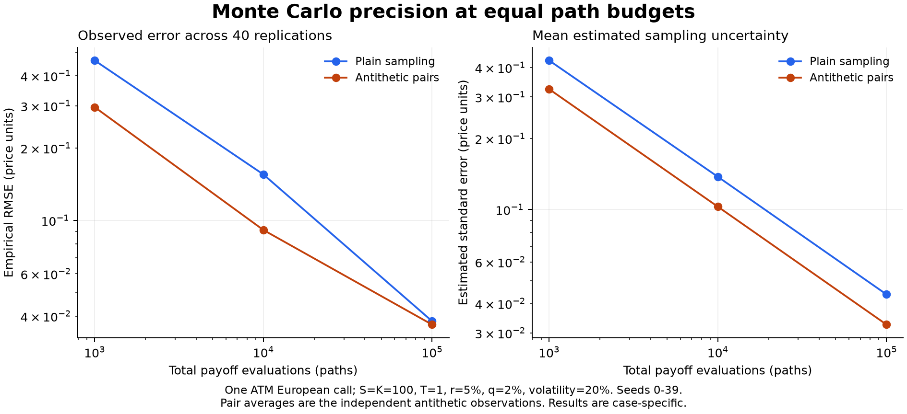

# Validation and simulation results

Recorded on 24 October 2026 with CPython 3.12.14, NumPy 2.5.4, and QuantLib 1.44 on Windows.
The numerical dependencies are pinned in `requirements-reproduction.txt`. All inputs are synthetic.

## QuantLib reconciliation

All **144 contracts and 864 comparisons passed** the declared absolute `1e-8` / relative `1e-10`
tolerances. These are comparisons of price and five Greeks under matching model assumptions.

| Quantity | Maximum absolute difference |
| --- | ---: |
| Price | 3.56e-14 |
| Delta | 2.39e-15 |
| Gamma | 3.89e-16 |
| Vega | 2.35e-13 |
| Theta | 9.26e-13 |
| Rho | 3.70e-13 |

These figures are rounded upward from the raw maxima. The full 144-case record is in
[`quantlib-validation.json`](../results/quantlib-validation.json).

## Equal-path Monte Carlo study

The reference call has S=K=100, T=1 year, r=5%, continuous q=2%, and sigma=20%.
Its analytical price is **9.227005508154036**. Each row below summarizes 40 seeded replications.



| Paths | Estimator | Empirical RMSE | Mean standard error | Observed 95% interval coverage |
| ---: | --- | ---: | ---: | ---: |
| 1,000 | Plain | 0.463411 | 0.428708 | 36/40 |
| 1,000 | Antithetic | 0.296210 | 0.324074 | 38/40 |
| 10,000 | Plain | 0.155411 | 0.137776 | 37/40 |
| 10,000 | Antithetic | 0.091255 | 0.102892 | 38/40 |
| 100,000 | Plain | 0.038088 | 0.043680 | 38/40 |
| 100,000 | Antithetic | 0.036851 | 0.032543 | 37/40 |

Both estimators become more accurate as the path budget grows in this experiment.
At 100,000 paths, antithetics lower the mean estimated standard error by about 25.5%, but
the empirical RMSE is only about 3.2% lower in these 40 replications. The latter comparison is
noisy and should not be replaced by a claim of a uniform 25.5% pricing-error improvement.

Coverage fractions are observed on 40 trials; they are not guarantees. Normal approximation
intervals can be misleading for rare payoffs, as demonstrated in the tests and explained in
[methodology](METHODOLOGY.md). The experiment does not establish market predictive performance.

## Reproduction

```bash
python -m pip install -r requirements-reproduction.txt
python -m pip install -e ".[plots]"
python scripts/validate_quantlib.py
python scripts/convergence_study.py
python scripts/plot_convergence.py
```

Elapsed times in the raw JSON are machine-specific. The reference grid and unit tests are
also run by CI; regenerated data need not match archived results bit for bit across platforms.
